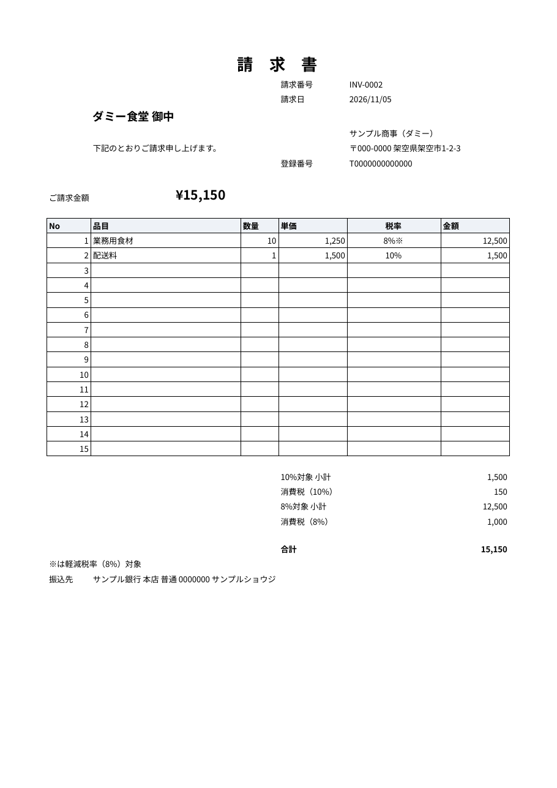

# 請求書PDF自動作成（Google Apps Script）

スプレッドシートに明細を書いて、メニューを1回押すだけ。請求番号ごとに**インボイス対応**の請求書PDFを作り、Googleドライブに保存します。

## できること

- 請求番号が同じ行を1枚の請求書にまとめる（明細15行まで）
- 10% / 8%（軽減税率）の混在に対応。税率ごとの小計と消費税を表示し、端数は税率ごとに1回切り捨て
- 軽減税率の明細に「※」を表示、適格請求書発行事業者の登録番号を記載
- 値引き行（マイナス金額）に対応
- 入力ミスはその請求だけ「エラー：〇〇が空」などと表示して、ほかは作成を続ける
- 作成済みの請求は作り直さない。エラーは直してもう一度押せば再作成

## 画面

作成されるPDF（ダミーデータ）：



## 導入手順

1. 新しいGoogleスプレッドシートを作る
2. 拡張機能 → Apps Script を開き、[`dist/請求書PDF_コード.txt`](dist/請求書PDF_コード.txt) の中身を `コード.gs` に全部貼って保存（`src/` の5ファイルをまとめたもの）
3. `setupDemo` を1回実行して権限を許可する（「設定」「明細」「ひな形」シートができる）
4. スプレッドシートを開き直し、メニュー **請求書 → PDF作成**

## シート

| シート | 中身 |
|---|---|
| 設定 | 自社名・住所・振込先・インボイス登録番号・保存フォルダ名 |
| 明細 | 請求番号・請求日・客名・品目・数量・単価・税率・状態・PDFリンク |
| ひな形 | 請求書の見た目（ふだんは非表示） |

## テスト

計算と入力チェック（`src/calc.js`）は自動テストがあります。Node.js 18 以上で：

```bash
npm test
```

Google上の動き（シート・PDF）は [手動テストのチェックリスト](docs/manual-test.md) で確認します。

## カスタマイズ例（有料対応）

メール自動送信、ロゴ入り、源泉徴収、複数通貨、freee / マネーフォワード連携など。

## 作成者

[yoneda2525](https://github.com/yoneda2525)（情報学部の学生）。設計と実装は AI（Claude）と一緒に行い、Google上での動作確認は作者が行いました。

スプレッドシート・Excel の面倒な作業の自動化（GAS / Python）を承ります。ご相談は [Issues](https://github.com/yoneda2525/gas-invoice-pdf/issues) からどうぞ。

